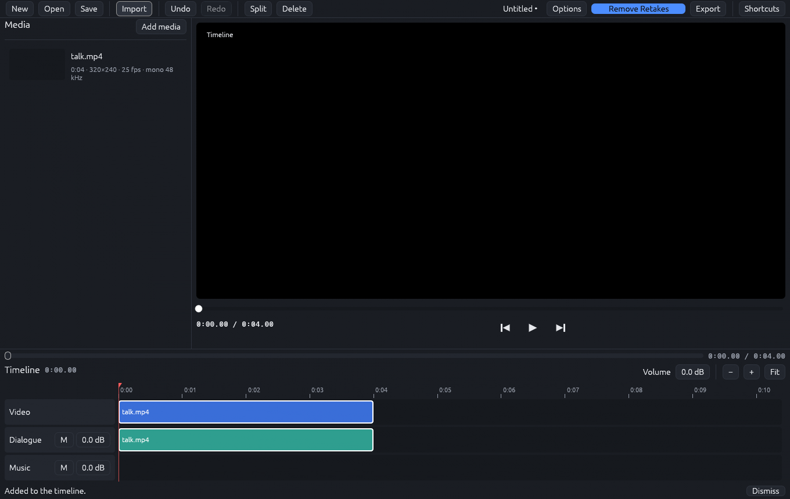

# Retake Editor

A small video editor for talking-head and YouTube videos. Its "Remove Retakes" button talks to the local retake service (`python -m service`, see [../service/README.md](../service/README.md)): the service finds and groups repeated sentences, you answer the pairs it is unsure about, tick the sentences to keep, and everything not kept is cut in one undoable step.

Rust workspace: `crates/core` (editor model, review and cut planning), `crates/service` (HTTP client of the service), `crates/ui` (egui panels), `apps/retake-editor` (the binary).



## Built on FilmCraft

The editing front end is built on [FilmCraft](https://github.com/storytold/filmcraft), an open-source video editor written in Rust (MIT OR Apache-2.0, copyright the ArtCraft Team and the FilmCraft contributors). Retake Editor does not copy FilmCraft's source; it depends on ten of its engine crates and puts its own, much smaller window and review workflow on top.

What is used from FilmCraft:

| FilmCraft crate | What Retake Editor uses it for |
|---|---|
| `filmcraft-engine` | the editing `Session` (command registry, undo and redo history, media pool, autosave and crash recovery); every edit goes through it |
| `filmcraft-project` | the document model: projects, tracks and clip items. Projects are saved as FilmCraft's native `.fcproj` files |
| `filmcraft-edit` | the pure timeline edit operations (for example `extract`, used to cut sentences out) |
| `filmcraft-render`, `filmcraft-frame` | evaluating the timeline for preview and mixing the audio (`render_sequence`, `render_item`, `mix_sequence`, `AudioBuffer`) |
| `filmcraft-export` | the render, encode and mux pipeline with progress and cancel, behind the Export dialog |
| `filmcraft-media`, `filmcraft-codecs` | probing imported files and decoding the common containers and codecs |
| `filmcraft-platform` | operating-system hardware video decoding (Media Foundation on Windows), with fallback to the pure-Rust decoders |
| `filmcraft-time` | the exact time unit (`Tick`) used on the timeline |

The window itself uses the same `egui` / `eframe` versions as FilmCraft. What Retake Editor adds is its own: the retake review (candidate pairs, groups, ticks to keep), the cut modes, the Retake options and progress panels, the HTTP client for the retake service, and the project-folder storage. FilmCraft's own UI crates and its ArtCraft branding are not used.

### Get the FilmCraft crates first

They are **not** part of this repository. Clone them next to `retake-editor/` (so they are at `<repo>/filmcraft`) and check out the commit this editor was built against:

```
git clone https://github.com/storytold/filmcraft filmcraft
git -C filmcraft checkout a504f3c5
```

FilmCraft is licensed MIT OR Apache-2.0; keep its `LICENSE-MIT`, `LICENSE-APACHE` and `NOTICE` files with any build you distribute. The folder is git-ignored here, so it is never committed by accident. Do not edit it; moving to a newer commit is a deliberate change that needs a rebuild and a test run.

## Build and run

Requirements: a recent stable Rust toolchain, FFmpeg and ffprobe on `PATH`. Windows is the platform it was developed and tested on; other platforms have not been tried.

```
cd retake-editor
cargo run --release                      # starts the editor
```

On Windows build from PowerShell, not Git Bash (Git's `link` shadows the MSVC linker). A full build needs roughly 10 GB of disk space; `cargo clean` frees it.

The editor looks for the service at `http://127.0.0.1:8765` (override with `RETAKE_EDITOR_SERVICE_URL`); start it with `uv run python -m service` from the repository root. `RETAKE_EDITOR_DATA_DIR` changes where its settings live. `RETAKE_EDITOR_FAKE_RETAKES=1` runs against a built-in stand-in service, so you can try the review flow without Python.

## Tests

```
cargo fmt --check
cargo clippy --workspace --all-targets -- -D warnings
cargo test --workspace
```

Tests that need ffmpeg print `SKIPPED` when it is missing; that is not a pass. Product code has no `unwrap`, `expect` or `panic!` (lints deny them). Every user action is an `Action` handled in one place (`RetakeEditorApp::perform`); panels only draw and queue actions.

## What the editor shows

- the review: candidate pairs to answer, groups, a tick per sentence to keep, a Keeper selector (hosted, local model, or keep-last) when the service offers one
- cut modes: Retakes and dead air (default), Retakes only, Speech only
- Retake options: transcription model (with size and speed), silence gap, re-split, set aside and restore transcription or keeper results
- progress with a log of the pipeline stages, and one Export dialog (presets, size, frame rate, codec, quality, audio, destination folder)

Sample documents the editor tests read are in [docs/examples/](docs/examples/); the contract they follow is in [../docs/api/](../docs/api/).
